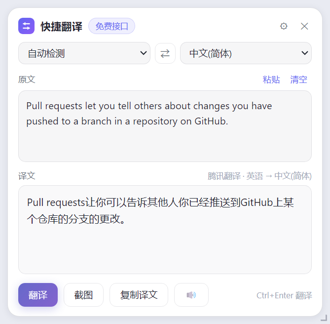
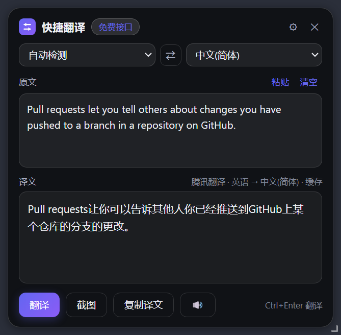
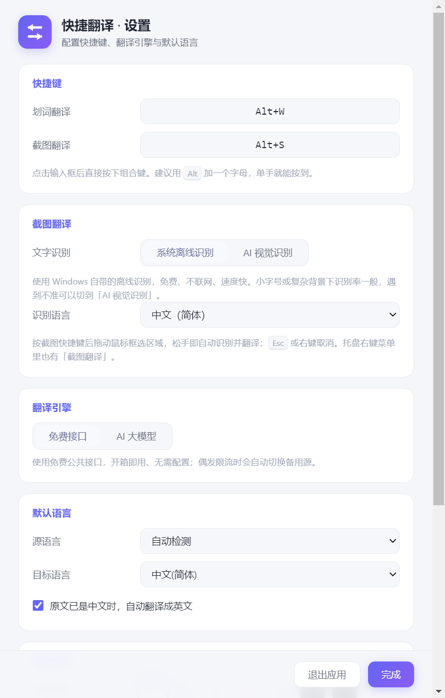

# 快捷翻译 · Quick Translator

常驻托盘的 Windows 翻译小工具。选中文字按一下快捷键，译文浮在鼠标旁边；选不中的文字就框选截图识别。

<p align="center">
  
  
</p>

## 功能

- **划词翻译** —— 选中任意文字，`Alt+W` 直接出译文，不打断当前操作
- **截图翻译** —— `Alt+S` 框选屏幕区域，离线 OCR 识别后自动翻译。视频内嵌字幕、图片文字、PDF 扫描件都能用
- **自动反向** —— 选中中文自动翻英文，选中英文自动翻中文，一个快捷键双向可用
- **两种引擎** —— 免费公共接口开箱即用；也可接入任意 OpenAI 兼容的大模型（DeepSeek / VibeAPI / 通义 / Kimi …）
- **可换配色** —— 浮窗背景色 7 种预设 + 自定义，深色自动反色
- 零生产依赖，Electron + 原生 HTML/CSS/JS，无前端框架

## 下载

到 [Releases](../../releases) 下载 `QuickTranslator-<版本>-portable.exe`（约 62 MB，自带运行时，无需安装 Node）。

> 首次运行 Windows 会提示「已保护你的电脑」，因为程序没有代码签名。点「更多信息」→「仍要运行」即可。

## 从源码运行

```bash
git clone https://github.com/<你的用户名>/quick-translator.git
cd quick-translator
npm install
npm start
```

也可以直接双击 `启动.bat`（会自动安装依赖并启动）。

> ⚠️ 启动前先从系统托盘右键退出旧版本，否则单实例锁会让新程序静默退出。

启动后程序常驻在**系统托盘**（右下角），关闭窗口不等于退出。

---

## 怎么用

| 操作 | 说明 |
| --- | --- |
| **Alt + W** | 抓取当前选中的文字并翻译（可自定义） |
| **Alt + S** | 截图翻译：框选屏幕区域，自动识别并翻译（可自定义） |
| 托盘图标单击 | 显示 / 隐藏翻译窗口 |
| 托盘右键 | 截图翻译、翻译剪贴板、设置、开机自启、退出 |
| `Ctrl + Enter` | 在窗口内翻译输入框内容 |
| `Esc` | 关闭窗口 |
| 拖动浮窗的边缘/右下角 | 自由调整宽度和高度（会记住窗口大小） |
| 原文右上角「粘贴 / 清空」 | 一键填入剪贴板 / 一键清空原文与译文 |
| 底部「截图」按钮 | 同 `Alt + S` |

**典型用法**：在浏览器、PDF、IDE、字幕里选中一段文字 → 按 `Alt+W` → 结果窗口出现在鼠标旁。

> 默认键选 `Alt+W` 是因为它正好落在左手 WASD 手位上（拇指按 Alt、无名指按 W），单手就能按，且浏览器没有占用。如果你机器上它被别的软件占了，设置页会直接提示注册失败，换一个即可。

窗口默认**失去焦点自动隐藏**（可在设置里关掉），所以点回原来的应用它就自己让开了。

### 智能反向

默认目标是中文。如果检测到你选中的**本身就是中文**，会自动改翻成英文——一个快捷键搞定双向。

---

## 截图翻译

遇到**选不中**的文字（视频内嵌字幕、图片里的文字、PDF 扫描件、游戏画面）就用它：

按 `Alt + S`（或托盘右键「截图翻译」）→ 屏幕变暗 → **拖动鼠标框选区域** → 松手自动识别并翻译。

- `Esc` 或**右键**取消
- 框选时右下角实时显示选区尺寸
- 框选完成到出结果约 1～3 秒（取决于识别方式）

### 两种识别方式

设置 → 截图翻译 → 文字识别：

| 方式 | 说明 |
| --- | --- |
| **系统离线识别**（默认） | 用 Windows 自带的 OCR 引擎。免费、不联网、约 1 秒出结果。小字号或复杂背景下会有形近字错误 |
| **AI 视觉识别** | 把截图直接交给支持看图的模型（如 `claude-haiku-4-5`、`gpt-5.5`、`gemini-3.6-flash`）。字幕、艺术字、复杂排版都明显更准，但需要配置大模型 API，每次会消耗 token |

> 离线识别需要系统装了对应语言包。程序会先试你选的语言，没有就退回系统默认语言。若报「没有可用的 OCR 引擎」，去「设置 → 时间和语言 → 语言和区域」给中文加装「基本键入/OCR」组件。

---

## 翻译引擎

### 免费接口（默认，开箱即用）

无需任何配置，按以下顺序自动降级：

| 顺序 | 引擎 | 说明 |
| --- | --- | --- |
| 1 | **腾讯交互翻译** | 主力。响应快、支持多语言、实测无频繁限流 |
| 2 | 有道智云 | 备用。有频率限制，已内置节流 |
| 3 | MyMemory | 备用。每日有免费额度上限 |
| 4 | Google 翻译 | 兜底。国内网络通常不可达 |

### AI 大模型（推荐长期使用）

免费接口依赖第三方公开接口，**存在失效风险**。配置一个 API Key 后可获得稳定、高质量的翻译，长句和术语处理明显更好，还能自动给单词补充词性释义。

设置 → 翻译引擎 → **AI 大模型**，内置常用服务商预设：

| 服务商 | 接口地址 | 模型 |
| --- | --- | --- |
| **VibeAPI 中转站** | `https://www.vibeapi.cn/v1` | 填你的账户实际可用的模型 ID |
| DeepSeek | `https://api.deepseek.com/v1` | `deepseek-chat` |
| 通义千问 | `https://dashscope.aliyuncs.com/compatible-mode/v1` | `qwen-plus` |
| Kimi | `https://api.moonshot.cn/v1` | `moonshot-v1-8k` |
| 智谱 GLM | `https://open.bigmodel.cn/api/paas/v4` | `glm-4-flash` |
| OpenAI | `https://api.openai.com/v1` | `gpt-4o-mini` |

你使用 VibeAPI 时，选它的预设 → 填写中转站的 **API Key** 和该中转站为你开通的 **模型 ID** → 点「测试连接」。模型 ID 以你的 VibeAPI 控制台为准，不能假定官方模型名一定可用。接口地址可以填写主页、`/v1` 或完整 `/v1/chat/completions`；其它 OpenAI 兼容中转站也可自定义。

> Key 会明文保存在本机用户数据目录 `config.json`，调用翻译时发给你配置的接口服务；请勿将这个配置文件或 Key 发给别人。

---

## 项目结构

```
main.js                 主进程：托盘、全局快捷键、窗口管理、IPC
preload.js              安全桥接（contextBridge）
src/translator.js       翻译引擎（免费多源降级 + 大模型）
src/selection.js        划词抓取（等待热键释放后发送 Ctrl+C，恢复剪贴板）
src/screenshot.js       截图框选遮罩 + 区域截取
src/ocr.js              Windows 离线 OCR + 视觉模型识别
src/config.js           配置持久化
renderer/
  index.html/app.js/style.css      翻译悬浮窗
  settings.html/settings.js/settings.css   设置页
  capture.html/capture.js/capture.css      截图框选遮罩
scripts/
  make-icon.js          零依赖生成应用图标
  ocr.ps1               Windows OCR 调用脚本（纯 ASCII）
  test-translate.js     翻译引擎自测
  test-grab.js          划词抓取自测（含性能）
  net-probe.js          网络与接口连通性诊断
  screenshot.js         界面截图
assets/                 图标
```

---

## 自测

```bash
node scripts/test-translate.js                              # 翻译引擎
node scripts/net-probe.js                                   # 接口连通性
node_modules/electron/dist/electron.exe scripts/test-selection-integration.js  # 真实选区
node_modules/electron/dist/electron.exe scripts/test-hotkey-integration.js      # 真实热键
node_modules/electron/dist/electron.exe scripts/test-window-layout.js          # 窗口布局
node scripts/test-vibeapi.js                                  # 中转站协议（模拟，不扣费）
node scripts/test-llm-prompt.js                               # 指令注入与闲聊拦截（模拟）
node_modules/electron/dist/electron.exe scripts/test-theme.js          # 窗口配色与清空
node scripts/test-config-migration.js                         # 快捷键默认值迁移
node_modules/electron/dist/electron.exe scripts/probe-shortcuts.js     # 探测本机空闲快捷键
node scripts/test-ocr.js                                      # OCR 文本清洗 + 真实识别
node_modules/electron/dist/electron.exe scripts/test-capture.js        # 框选与裁剪换算
```

---

## 窗口外观

设置 → **窗口外观**，可以改翻译浮窗的整体背景色：

- 7 个常用配色（纯白 / 浅灰 / 米色 / 淡紫 / 雾蓝 / 深灰 / 纯黑）
- 也可以用取色器或直接填 `#RRGGBB` 自定义

选深色会自动把文字、边框、滚动条切成浅色，不需要另外设置。窗口用**细描边 + 贴身轻投影**勾出边界：纯白背景下也能看清窗口范围，又不会糊成一圈灰晕。

<p align="center">
  
  
</p>

---

## 关于体积

便携版约 **62 MB**，其中 99.9% 是 Electron（Chromium + Node）运行时，本项目的代码只有几十 KB。构建时会做两件事压体积：

- `afterPack` 钩子（`scripts/after-pack.js`）删掉 53 个用不到的语言包、`LICENSES.chromium.html`（8.8 MB 纯法律文本）和 `resources/default_app.asar`，解包后省约 48 MB
- `compression: maximum` 用 LZMA 最高档压缩

不过要说明的是：**语言包本身已是压缩格式，解包省 48 MB 反映到 exe 上只有约 6.5 MB**（69.1 → 62.5 MB）。剩下的体积基本是 Electron 的硬底，想再小一个数量级只能换技术栈（如 Tauri 用系统 WebView2，可做到 5 MB 以内），那需要重写。

---

## 常见问题

**快捷键没反应？**
可能被输入法或其他软件占用。设置页的快捷键框在注册失败时会直接标红提示。建议优先试 `Alt+W` / `Alt+X` / `Alt+C` 这类单修饰键组合，避开 `Ctrl+Space`、`Ctrl+Shift` 单独键和浏览器的 `Alt+D`（地址栏）、`Alt+E`（菜单）。

> 换默认快捷键时，程序只会在**你没改过**的情况下自动升级，自己设过的组合不会被覆盖。

**抓不到选中的文字？**
新版会等待 Ctrl/Shift/D 松开后才复制。请先确认退出旧程序再运行新版；管理员权限运行的程序、某些游戏、视频画面里的字仍可能无法复制。此时可先手动 `Ctrl+C`，再从托盘选择「翻译剪贴板内容」；无法选中的字幕需要另行接入 OCR。

**翻译失败 / 很慢？**
先跑 `node scripts/net-probe.js` 看接口是否可达。国内网络下 Google 不可用属正常，腾讯源是主力。长期使用建议配置 AI 引擎。

**AI 翻译出来是聊天内容，不是译文？**
部分中转渠道（尤其 IDE 助手类通道，如 Kiro）会覆盖掉请求里的 system 提示词，模型于是以为在跟你对话，回一句「我是 XX 助手」。本工具已做处理：翻译指令写在 user 消息里、识别到闲聊会自动换一套更硬性的框架重试一次，并在译文右上角标注「已自动重试」。如果某个渠道始终这样，说明它彻底不吃外部指令，建议在 VibeAPI 控制台给令牌换一个分组，或改用 `glm-5.3-flash`、`grok-4.5` 等模型。

**怎么开机自动启动？**
设置 → 行为 → 开机自动启动。开机自启时不会弹窗，安静驻留托盘。

**截图翻译识别不准 / 有错别字？**
离线 OCR 对小字号、低对比度和复杂背景比较吃力，会出现形近字错误（如「引擎」认成「引掌」）。解决办法：① 框选时尽量只框住文字、放大后再截；② 设置里把识别方式切到「AI 视觉识别」，准确率会明显提升。

**截图翻译提示「没有可用的 OCR 引擎」？**
系统缺少对应语言的 OCR 语言包。到「设置 → 时间和语言 → 语言和区域」，给中文（简体）添加「可选语言功能」里的基本键入/OCR 组件；或直接把识别方式切成「AI 视觉识别」。

**怎么确认 OCR 在你的机器上能用？**
拿任意一张含文字的图片跑自检，它会打印所用脚本路径和识别结果：

```bash
"release/QuickTranslator-1.3.1-portable.exe" --selftest-ocr="C:\路径\到\图片.png"
```

结尾出现 `SELFTEST OK` 就说明离线识别链路正常。

**怎么彻底退出？**
托盘右键 → 退出，或设置页底部「退出应用」。直接关窗口只是隐藏。

---

## 说明

- 程序是**本地桌面应用**，但翻译需要联网（免费公共接口，或你自己配置的大模型）
- 划词翻译要求文字**可被复制**；视频画面、图片里的文字请用 `Alt+S` 截图翻译
- 某些提权窗口或禁止复制的应用无法抓取，可先复制文本，再从托盘选「翻译剪贴板内容」
- 便携版未做代码签名，Windows SmartScreen 提示未知发布者属正常现象
- 免费翻译接口是各网站前端的公开端点，不保证长期可用；追求稳定性建议配置大模型

## 许可

[MIT](LICENSE)
